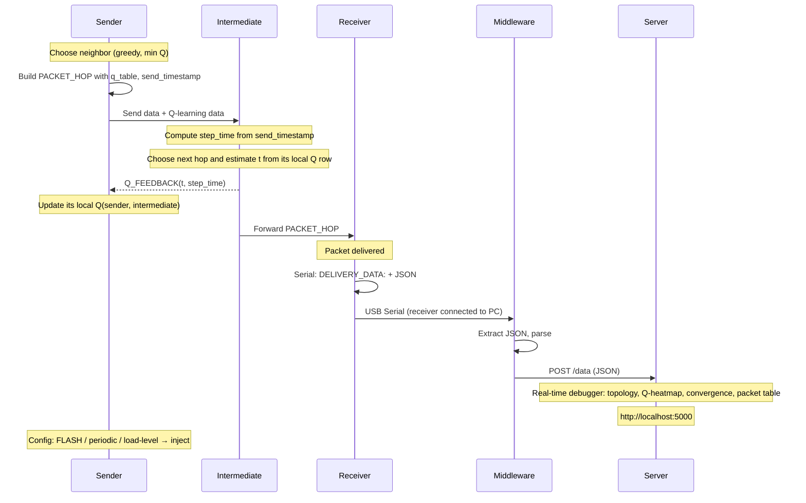
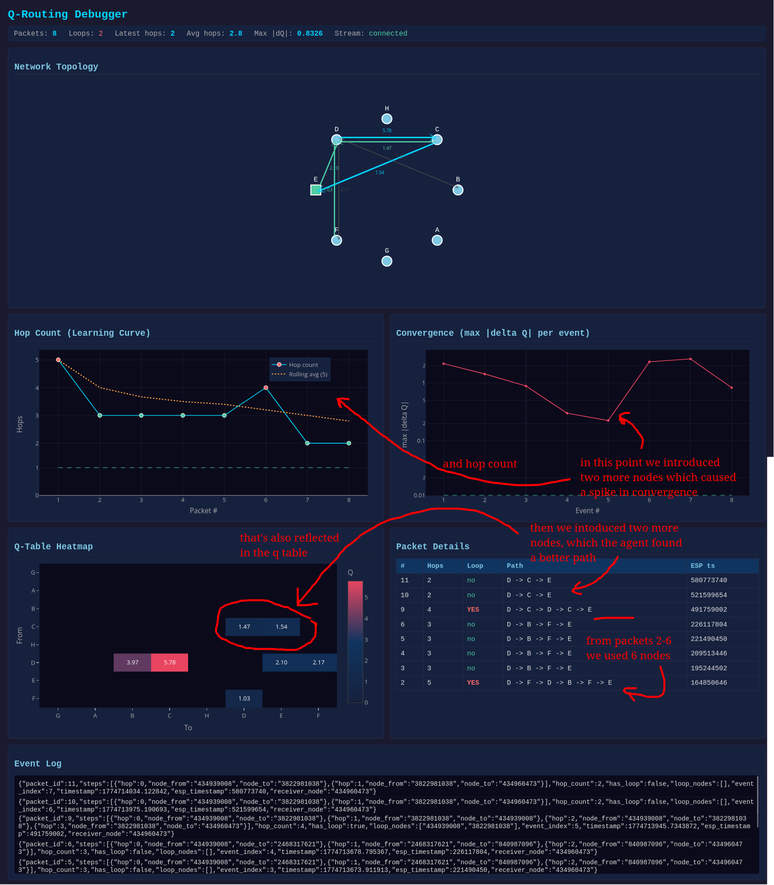

# Mesh Routing with Q-Routing (TD(0))

This project implements a mesh network routing system using **Q-Routing** as described in Boyan & Littman (1994), *Packet Routing in Dynamically Changing Networks: A Reinforcement Learning Approach*. The algorithm uses **TD(0) temporal-difference updates** to minimize packet delivery time. Implemented with ESP devices and the painlessMesh library.

Each ESP device handles packet reception and transmission in the mesh network. The routing logic minimizes **estimated delivery time**. Q-values represent the estimated time to deliver a packet to the destination via each neighbor—**lower Q means a better path**.

## Project layout

| Path | Contents |
|------|----------|
| `firmware/` | ESP8266 sketches—one folder per node (folder name = main `.ino` basename for Arduino CLI) |
| `data/` | LittleFS image source (sender): `injection-schedule.json` — upload with PlatformIO `uploadfs` |
| `tools/` | Host-side Python: serial middleware (`learning-results-grabbing`) and real-time visualization server (`learning-visualization-server`) |

## Node Roles

| Role | File | Behavior |
|------|------|----------|
| **Sender** | `firmware/sender-node/sender-node.ino` | Packet injection schedule from LittleFS (`data/injection-schedule.json`): **FLASH** only, **periodic**, or **load-level** stochastic; then greedy first hop |
| **Intermediate** | `firmware/intermediate-node/intermediate-node.ino` | Forwards packets to a direct mesh connection and returns Q-feedback |
| **Receiver** | `firmware/receiver-node/receiver-node.ino` | Packet destination; receives and logs delivery |



**Local-learning flow:** Every node keeps its own Q row in RAM and chooses from that row. A receiver of a hop sends its local remaining-time estimate backward in a unicast `Q_FEEDBACK`; the previous node then updates the action it actually used. The sender’s **injection schedule** (LittleFS JSON) selects **PHYSICAL_BUTTON_DRIVEN** (FLASH on GPIO0), **PERIODIC** (one packet every `tick_ms`), or **LOAD_LEVEL** (expected `load_level` packets per `tick_ms`, stochastic rounding). If the file is missing or invalid, defaults match **PHYSICAL_BUTTON_DRIVEN**.

### Direct neighbors and painlessMesh transport

`mesh.getNodeList(false)` is the set of all known reachable nodes, including
nodes reached through another mesh member. It is not an action set for
Q-Routing. The firmware instead reads the first level of
`mesh.asNodeTree().subs`. In painlessMesh 1.5.7 that tree level is constructed
from the node's active `Mesh::subs` TCP connections; descendants are only
indirectly reachable nodes.

Every application-level Q hop is therefore sent to an active direct
painlessMesh connection. `sendSingle()` is still the transport operation, but
the selected target is first verified to be in that direct set, so a
`PACKET_HOP` does not intentionally delegate an application hop to
painlessMesh's multihop router. A direct painlessMesh TCP connection is the
library-level link abstraction; the firmware does not claim independent RF
neighbor discovery below that abstraction.

The action set is rebuilt from the live topology for every decision. A
disconnected ID remains in the RAM Q-table but cannot be selected. If it
reconnects with the same ID, its learned value is reused. A genuinely new ID is
initialized to `INITIAL_Q`.


**Visualization (optional):** When the receiver is connected via USB to a PC, it outputs `DELIVERY_DATA:` + JSON on Serial. The middleware reads this, extracts the JSON, and forwards it to the visualization server. Open http://localhost:5000 for the real-time Q-Routing Debugger — topology, learning curves, Q-table heatmap, convergence tracking, packet details, and event log, all updating live via SSE.

## How the Learning Works

### Q-Values

- **Q(from, to)** = estimated time to deliver a packet from the current node to the destination via neighbor `to`
- **Lower Q** = faster path = better choice

### Update Rule (Boyan & Littman 1994)

When a packet arrives from node `x`, the receiving node reports its estimate and `x` updates the link that was traversed:

```
ΔQ_x(d,y) = η × ((q + s + t) - Q_x(d,y))
```

Where:
- **q** = time in queue (0). AsyncTCP exposes only send-buffer info (`space()`, `canSend()`), not receive queue size or per-packet queue delay. painlessMesh does not expose the underlying TCP connections. We cannot measure queue time without an application-level queue.
- **s** = transmission time (measured via `send_timestamp` in the packet)
- **t** = our estimate of remaining time = min over our neighbors of Q(us, neighbor)
- **η** = learning rate (eta, default 0.7)

### Action Selection

- **Greedy:** Always choose the neighbor with the **minimum** Q-value

### Flow

1. **Sender** sends a packet, picks first hop, sends `PACKET_HOP` with `send_timestamp`
2. **Intermediate** receives, picks the next hop and computes `t` from its persistent local Q row, sends `Q_FEEDBACK` to the previous node, and forwards
3. **Previous node** applies `Q_new = Q_old + eta * (step_time + t - Q_old)` once when the feedback arrives
4. **Receiver** sends feedback with `t = 0`; the packet is delivered and is not forwarded
5. **Sender** injects the next packet per its schedule (button, timer, or load level — no delivery callback)

## Message Structure

Routing uses **PACKET_HOP** plus the small backward **Q_FEEDBACK** message. `DELIVERY_DATA` keeps the delivered `PACKET_HOP` document shape for the host tools. Structure:

```json
{
    "type": "PACKET_HOP",
    "current_node_id": "434960473",
    "send_timestamp": 12345678,
    "hyperparameters": {
        "eta": 0.7
    },
    "current_packet_id": 1,
    "hops_remaining": 23,
    "packets": [
        {
            "packet_id": 1,
            "steps": [
                {
                    "hop": 0,
                    "node_from": "434939008",
                    "node_to": "434960473"
                }
            ]
        }
    ],
    "q_table": {
        "434939008": { "434960473": 0.5 },
        "434960473": { "434939008": 0.3 }
    }
}
```

- **send_timestamp** (µs): Used by the receiver to compute actual transmission time
- **q_table**: telemetry snapshot, wire-compatible with the existing tools. The sender seeds it from its local row; each visited node publishes its own local row, and the traversed entry records the update implied by the emitted feedback. It is not a routing input and never overwrites a node's local table.
- **hops_remaining**: remaining application-level Q hops. It starts at
  `MAX_Q_HOPS` (24 by default), is consumed before each send, and prevents a
  greedy loop from circulating forever. It does not count internal radio/TCP
  transmissions.
- **packets**: exactly one object for the current packet; **packet_id**
  identifies it and **steps** records only its hop path. Historical packet
  records are not carried over the mesh. The sender advances the ID only after
  painlessMesh accepts the first hop into its queue; immediate failed attempts
  reuse the same ID.

## Setup

### Hardware

- 2+ ESP8266 devices
  - `firmware/sender-node/` → sender
  - `firmware/intermediate-node/` → intermediate
  - `firmware/receiver-node/` → receiver
- Micro-USB data cable
- Linux machine with `arduino-cli`

### Arduino CLI setup on Linux

Install `arduino-cli` and configure the ESP8266 core:

```bash
$ arduino-cli config init
```

Edit `~/.arduino15/arduino-cli.yaml` and add:

```yaml
board_manager:
  additional_urls:
    - https://arduino.esp8266.com/stable/package_esp8266com_index.json
```

Then install the ESP8266 core:

```bash
$ arduino-cli core update-index
$ arduino-cli core install esp8266:esp8266@3.1.2
```

Install required libraries:

```bash
$ arduino-cli lib update-index
$ arduino-cli lib install "Painless Mesh@1.5.7"
$ arduino-cli lib install "ESPAsyncTCP@1.2.4"
$ arduino-cli lib install "ArduinoJson@7.4.3"
$ arduino-cli lib install "TaskScheduler@4.0.4"
```

## Detect the board

Connect the ESP8266 through USB and verify that the OS detects it:

```bash
$ lsusb
$ arduino-cli board list
```

A NodeMCU board typically appears as something like:

```bash
$ /dev/ttyUSB0 serial Serial Port (USB)
```

## Compile

For NodeMCU ESP8266, use:

```bash
$ arduino-cli compile --library lib/QMeshCommon --fqbn esp8266:esp8266:nodemcuv2 ./firmware/sender-node
$ arduino-cli compile --library lib/QMeshCommon --fqbn esp8266:esp8266:nodemcuv2 ./firmware/intermediate-node
$ arduino-cli compile --library lib/QMeshCommon --fqbn esp8266:esp8266:nodemcuv2 ./firmware/receiver-node
```

### PlatformIO (optional)

From the repository root, each sketch is a separate environment (`src_dir` points at `firmware/<node>/`):

```bash
pio run -e sender -e intermediate -e receiver
```

**Sender filesystem (injection schedule):** Edit `data/injection-schedule.json`, then upload LittleFS to the **sender** board:

```bash
pio run -e sender -t uploadfs
```

If you skip `uploadfs`, the sender uses built-in defaults (FLASH-driven injection).

## Upload

Upload each sketch to the corresponding board:

```bash
$ arduino-cli upload -p /dev/ttyUSB0 --fqbn esp8266:esp8266:nodemcuv2 ./firmware/sender-node
$ arduino-cli upload -p /dev/ttyUSB0 --fqbn esp8266:esp8266:nodemcuv2 ./firmware/intermediate-node
$ arduino-cli upload -p /dev/ttyUSB0 --fqbn esp8266:esp8266:nodemcuv2 ./firmware/receiver-node
```

## Serial monitoring

To inspect logs from a node, use arduino-cli monitor.

Normal firmware logging omits full mesh JSON messages. The receiver retains the
machine-readable `DELIVERY_DATA:<JSON>` stream. All three sketches use 115200
baud:

```bash
$ arduino-cli monitor -p /dev/ttyUSB0 -c baudrate=115200
```
## Network bring-up order

1. Power on the receiver
2. Power on any intermediate nodes
3. Power on the sender

The sender injects packets per **`data/injection-schedule.json`** (e.g. FLASH, periodic, or load level); intermediate nodes forward packets and update Q-values; the receiver logs deliveries.

**Important:** Routing is one-shot over the current direct-connection graph. If
the graph is incomplete, a node with no direct action drops the packet; the old
packet does not wait for reconnection. New packets use the updated topology.
The receiver is identified by running the receiver firmware, not by a
configured destination ID. Consequently it can disappear and rejoin without
updating a stored destination, but its own RAM learning is lost on reboot. The
design assumes one receiver role; multiple receiver-firmware nodes would all be
terminal destinations.

**Troubleshooting “receiver never sees the packet”:** (1) Confirm the graph is
connected by direct painlessMesh links. (2) Request a diagnostic snapshot and
inspect each node's direct actions and drop counters. (3) Look for TTL,
no-neighbor, invalid-JSON, and enqueue-exhaustion drops. `PACKET_HOP` is capped
at 6144 serialized bytes and a 24-hop history.

### Visualization (optional)

Connect the **receiver** via USB to a PC to visualize learning progress in real time:

```bash
# Terminal 1: Start visualization server
cd tools/learning-visualization-server && pip install -r requirements.txt && python server.py

# Terminal 2: Start middleware (receiver connected via USB)
cd tools/learning-results-grabbing && pip install -r requirements.txt && python middleware.py --verbose
```

Open http://localhost:5000 for the **Q-Routing Debugger** — a real-time dashboard with six views:

| View | What it shows |
|------|---------------|
| **Network Topology** | Directed graph with Q-value edge labels. Green edges = preferred next-hop (argmin Q). Blue = latest packet path. Red = loop edges. Sender (diamond), receiver (square) visually distinct. Short node labels (A-F), full ID on hover. |
| **Hop Count (Learning Curve)** | Hops per packet with rolling average (window=5). Green markers = clean delivery, red = loop detected. Dashed line at y=1 shows theoretical optimum. |
| **Convergence** | max |delta Q| per event on log scale. Trends toward zero as learning stabilizes. Dashed threshold at 0.01. |
| **Q-Table Heatmap** | NxN grid (from/to) colored by Q-value intensity. Shows which edges have been explored and current value landscape. |
| **Packet Details** | Table with packet #, hop count, loop flag, path (short labels), and ESP timestamp. Newest first. |
| **Event Log** | Last 20 raw events for debugging data flow. |

The dashboard updates automatically via Server-Sent Events (SSE) — no browser refresh needed. A status bar shows live packet count, loop count, latest/average hops, max |dQ|, and SSE connection state.

On restart, the server replays `received_data.log` to rebuild state, so no data is lost between sessions.

### Start a fresh experiment

Stop both the middleware and visualization server, then clear their generated
history from the repository root:

```bash
tools/reset-experiment.sh
```

To inspect the affected files without changing them:

```bash
tools/reset-experiment.sh --dry-run
```

The command truncates only `learning_results_log.txt` and `received_data.log`.
Restart the visualization server afterward so its in-memory graph state also
starts empty.

### On-demand distributed diagnostics

With the receiver connected over USB, pass `--diagnostics` to the middleware:

```bash
cd tools/learning-results-grabbing
python middleware.py --diagnostics
```

The middleware writes `D` once after opening the serial port. The receiver
broadcasts a `DIAG_REQUEST`; every node schedules a staggered response and sends
a compact `DIAG_RESPONSE` to that receiver. Responses are printed as
`DIAG_DATA:<JSON>`. Each includes the unsigned node ID, role, uptime, free heap,
direct connections, reachable-node count, local Q row, and routing/drop/send/
feedback counters. It also reports whether that node knows a receiver identity;
under the current role-based design only the receiver knows its own ID, while
sender and intermediate responses report a null receiver ID. Diagnostics are
not periodic and do not update Q-values.
They do consume mesh bandwidth while the snapshot is collected, so request
them between measurement bursts when timing isolation matters.




## Configuration

### Sender: `data/injection-schedule.json` (LittleFS)

Stored as JSON (same fields as a YAML `injection_schedule` block). Upload with `pio run -e sender -t uploadfs`.

```json
{
  "injection_schedule": {
    "mode": "PHYSICAL_BUTTON_DRIVEN",
    "tick_ms": 10000,
    "load_level": 2.4,
    "seed": 42
  }
}
```

| Field | Meaning |
|-------|--------|
| `mode` | `PHYSICAL_BUTTON_DRIVEN` — inject on FLASH press. `PERIODIC` — one packet every `tick_ms`. `LOAD_LEVEL` — each `tick_ms`, inject `floor(L)` packets plus one extra with probability `L - floor(L)` (expected rate `L` per tick). |
| `tick_ms` | Interval for `PERIODIC` / `LOAD_LEVEL` (minimum enforced in firmware: 100 ms). |
| `load_level` | Mean packets per tick for `LOAD_LEVEL` (`L` ≥ 0). |
| `seed` | RNG seed for load-level draws; `0` = non-reproducible seed at boot. |

Per tick, load-level injection count is capped (firmware constant) to avoid flooding the mesh.

### Firmware constants

| Parameter | Default | Description |
|-----------|---------|-------------|
| `eta` | 0.7 | Learning rate |
| `INITIAL_Q` | 0.0 | Initial Q-value (lower = better) |
| `FLASH_BUTTON_PIN` (sender) | `0` | NodeMCU FLASH → GPIO0; override if your board uses another pin (`#define` before compile) |
| `FLASH_DEBOUNCE_MS` (sender) | `300` | Minimum time between injects on repeated edges (button mode) |
| `MAX_Q_HOPS` | `24` | Maximum application Q hops before a looped packet is dropped |
| `MAX_PACKET_JSON_SIZE` | `6144` | Maximum serialized mesh packet size accepted or emitted |
| `MESH_SERIAL_BAUD` | `115200` | Firmware and middleware serial rate |
| `VERBOSE_MESH_LOGS` | `0` | Set to 1 at compile time to print complete mesh messages (not recommended for timing experiments) |

## Delivery and restart limitations

- A successful `sendSingle()` means painlessMesh accepted the message into its
  queue. It is not an end-to-end delivery acknowledgement. The bounded retries
  only cover immediate enqueue or route rejection; a queued frame can still be
  lost later.
- There is no packet ACK/retransmission protocol and no feedback deduplication.
  A lost `Q_FEEDBACK` loses that learning update; a duplicate feedback applies
  the update again.
- Q-tables are intentionally RAM-only. Other surviving nodes retain values for
  a stable rejoining ID, while a rebooted node begins learning its own row
  again.
- ESP8266 painlessMesh IDs derive from the device network identity and normally
  remain stable across ordinary reboots. All firmware and JSON paths treat IDs
  as unsigned 32-bit decimal values.
- Receiver discovery is role-based only in the sense that receiver firmware
  terminates any `PACKET_HOP` that reaches it. There is no advertised receiver
  ID or destination-specific Q-table dimension.

## References

- Boyan, J. A., & Littman, M. L. (1994). *Packet Routing in Dynamically Changing Networks: A Reinforcement Learning Approach*
- [meshroutingframework](https://github.com/yourusername/meshroutingframework) — Java simulation with the same Q-routing logic

## Demos

Demo 1:
[](https://youtu.be/WYOyJp7k9bQ)

Demo 2:
[](https://youtu.be/fHp0AZggZRo)
